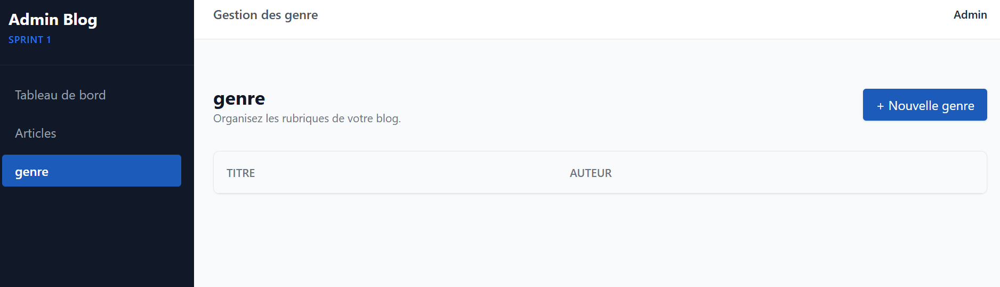

# Projet Technique :

## 1. Sujet du projet

Le projet consiste à développer une application web de **gestion de bibliothèque** permettant de gérer les livres d'une bibliothèque.

## 2. Objectif du projet

c'est de  **faciliter la gestion des livres** et de simplifier le travail du Bibliothèque.

L'application permet de :

- Ajouter de nouveaux livres.
- Afficher la liste des livres.
- Organiser les livres de manière efficace.
#
# 7. Image du projet

